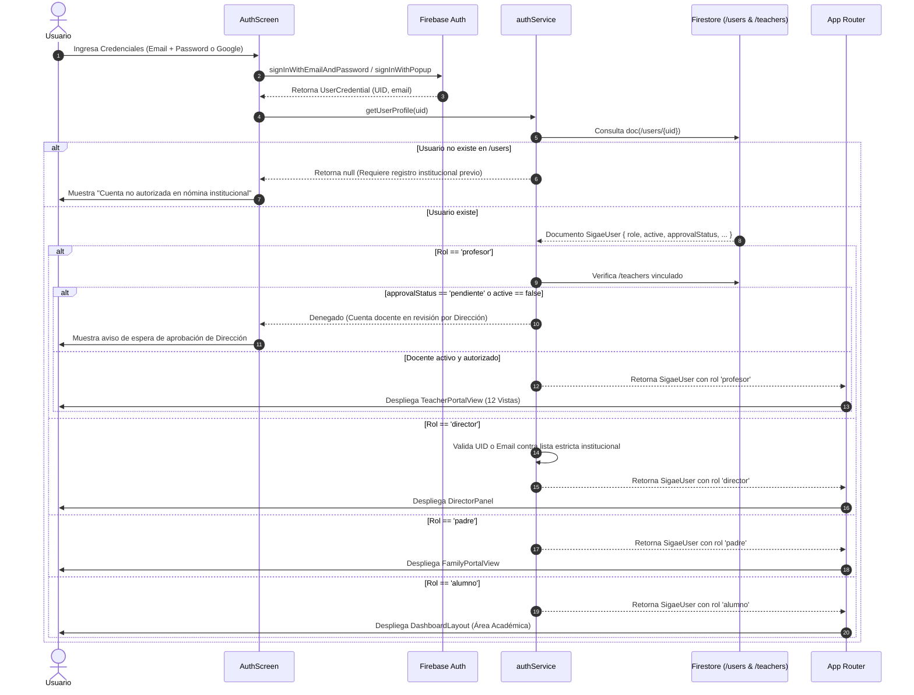
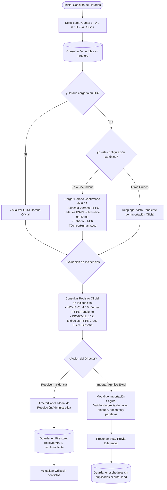
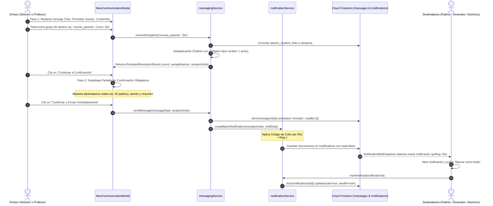
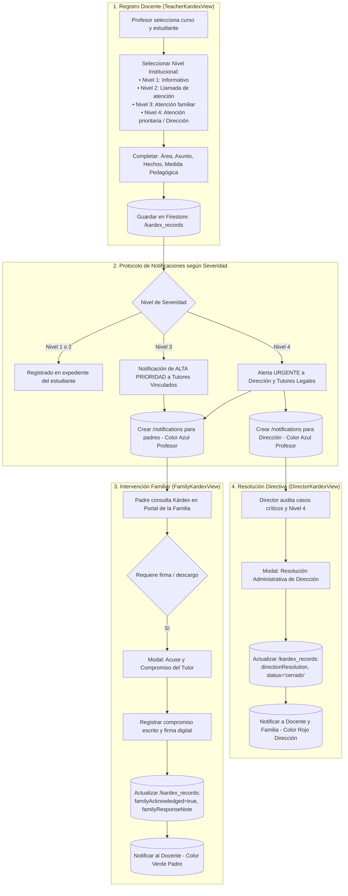

# SIGAE — ARQUITECTURA TÉCNICA INSTITUCIONAL
## Sistema Integral de Gestión Académica Escolar
**Unidad Educativa «Luis Espinal Tarde de Collpani» (El Alto, Bolivia · SIE: 80730142)**  
*Gestión Académica Oficial: 2026*

---

## 1. INTRODUCCIÓN Y PRINCIPIOS DE ARQUITECTURA

SIGAE es una plataforma de gestión académica integral diseñada para responder a la realidad institucional de la U.E. Luis Espinal Tarde de Collpani. Opera sobre una arquitectura moderna basada en **React 19**, **TypeScript**, **Firebase Authentication** y **Cloud Firestore**, garantizando:

1. **Cero confianza en el cliente (Zero-Trust RBAC):** Los roles y permisos (`director`, `profesor`, `padre`, `alumno`) están estrictamente encapsulados en el servidor y validados mediante reglas de seguridad de Firestore (`firestore.rules`). Ningún cliente puede autoasignarse roles ni escalar privilegios.
2. **Patrón Singleton y Centralización de SDK:** La inicialización de Firebase está centralizada en `src/firebase/config.ts`. No existen clientes redundantes ni escuchas huérfanas al cerrar sesión.
3. **Integridad de Datos Reales:** Se prohíbe el uso de datos simulados o autogeneración destructiva de horarios en el arranque de la aplicación.
4. **Respeto a la Normativa Educativa Boliviana (Ley 070 Avelino Siñani - Elizardo Pérez):** Dimensiones evaluativas (*Saber*, *Hacer*, *Ser y Decidir*, *Autoevaluación*), gestión de 24 cursos de secundaria (1.° a 6.°, paralelos A, B, C, D) y Kárdex institucional en 4 niveles de severidad.

---

## 2. DIAGRAMAS DE ARQUITECTURA (MERMAID)

### 2.1 Diagrama 1: Visión General del Sistema (System Overview)

Muestra la interacción entre las capas de usuario, el frontend React con TypeScript, los servicios de aplicación y los servicios backend de Firebase.

```mermaid
graph TD
    subgraph Usuarios["Actores Institucionales"]
        DIR["Director Titular"]
        PROF["Profesor / Docente"]
        PAD["Padre / Madre / Tutor"]
        ALU["Estudiante / Alumno"]
    end

    subgraph Frontend["Capa de Presentación (React SPA + Tailwind CSS)"]
        UI_AUTH["AuthScreen / LoginModal"]
        UI_DIR["DirectorPanel"]
        UI_PROF["TeacherPortalView"]
        UI_FAM["FamilyPortalView"]
        UI_ALU["AlumnoDashboard / DashboardLayout"]
        UI_CAL["UnifiedSchoolCalendar (Android Dark Style)"]
        UI_SCHED["OfficialScheduleManager (24 Cursos Secundaria)"]
        UI_KDX["Módulos Kárdex (Teacher / Family / Director)"]
        UI_NOTIF["NotificationBellDropdown (4 Códigos de Color)"]
    end

    subgraph Services["Servicios de Negocio (TypeScript / src/firebase)"]
        AUTH_SVC["authService"]
        DIR_SVC["directorService"]
        SCHED_SVC["scheduleService"]
        STUD_SVC["studentService"]
        ATT_SVC["attendanceService"]
        MSG_SVC["messagingService"]
        CAL_SVC["calendarService"]
        KDX_SVC["kardexService"]
        NOTIF_SVC["notificationService"]
    end

    subgraph Backend["Capa de Persistencia y Seguridad (Firebase)"]
        FB_AUTH["Firebase Authentication (Email/Password & Google)"]
        CF_USERS[("Firestore: /users")]
        CF_TEACHERS[("Firestore: /teachers")]
        CF_STUDENTS[("Firestore: /students")]
        CF_LINKS[("Firestore: /parent_student_links")]
        CF_SCHED[("Firestore: /schedules")]
        CF_ATT[("Firestore: /attendance_sessions")]
        CF_MSG[("Firestore: /messages")]
        CF_EVENTS[("Firestore: /calendar_events")]
        CF_NOTIF[("Firestore: /notifications")]
        CF_KDX[("Firestore: /kardex_records")]
        RULES["Reglas de Seguridad (firestore.rules)"]
    end

    DIR --> UI_DIR
    PROF --> UI_PROF
    PAD --> UI_FAM
    ALU --> UI_ALU

    UI_DIR --> UI_CAL & UI_SCHED & UI_KDX & UI_NOTIF
    UI_PROF --> UI_CAL & UI_KDX & UI_NOTIF
    UI_FAM --> UI_CAL & UI_KDX & UI_NOTIF
    UI_ALU --> UI_CAL & UI_NOTIF

    UI_AUTH --> AUTH_SVC
    UI_DIR --> DIR_SVC & SCHED_SVC & MSG_SVC & KDX_SVC
    UI_PROF --> SCHED_SVC & STUD_SVC & ATT_SVC & KDX_SVC & NOTIF_SVC
    UI_FAM --> STUD_SVC & KDX_SVC & NOTIF_SVC
    UI_ALU --> STUD_SVC & SCHED_SVC & NOTIF_SVC

    AUTH_SVC --> FB_AUTH & CF_USERS
    DIR_SVC --> CF_TEACHERS & CF_USERS
    SCHED_SVC --> CF_SCHED
    STUD_SVC --> CF_STUDENTS & CF_LINKS
    ATT_SVC --> CF_ATT
    MSG_SVC --> CF_MSG & NOTIF_SVC
    CAL_SVC --> CF_EVENTS & CF_MSG
    KDX_SVC --> CF_KDX & NOTIF_SVC
    NOTIF_SVC --> CF_NOTIF

    Backend --- RULES
```

---

### 2.2 Diagrama 2: Flujo de Autenticación y Verificación de Roles (RBAC)

Representa el proceso riguroso de inicio de sesión, validación de estado activo, verificación de nómina y derivación al panel autorizado.

---

### 2.3 Diagrama 3: Flujo de Gestión de Horarios y Resolución de Incidencias

Detalla el ciclo de vida de los horarios escolares para los 24 cursos de secundaria, la verificación de bloques y la resolución de conflictos institucionales.

---

### 2.4 Diagrama 4: Flujo de Mensajería, Comunicaciones y Notificaciones

Describe la resolución y deduplicación de destinatarios, el modal de confirmación obligatoria en dos pasos y el sistema de notificaciones con código de color institucional.

---

### 2.5 Diagrama 5: Flujo Integral de Kárdex Institucional

Especifica la creación de anotaciones en los 4 niveles de severidad institucional, el despacho de alertas prioritarias, la respuesta y descargo familiar y la resolución administrativa de Dirección.

---

### 2.6 Diagrama 6: Modelo de Datos Cloud Firestore (Entity-Relationship)

Detalla la estructura de colecciones, campos y relaciones clave del sistema SIGAE.

```mermaid
erDiagram
    USERS ||--o{ TEACHERS : "vinculado a expediente"
    USERS ||--o{ PARENT_STUDENT_LINKS : "posee vínculos"
    STUDENTS ||--o{ PARENT_STUDENT_LINKS : "es vinculado a"
    COURSES ||--o{ SCHEDULES : "contiene bloques de"
    COURSES ||--o{ ATTENDANCE_SESSIONS : "sesiones diarias de"
    STUDENTS ||--o{ ATTENDANCE_RECORDS : "asistencia individual"
    ATTENDANCE_SESSIONS ||--o{ ATTENDANCE_RECORDS : "incluye registros de"
    STUDENTS ||--o{ KARDEX_RECORDS : "expediente disciplinario"
    USERS ||--o{ KARDEX_RECORDS : "docente emisor"
    USERS ||--o{ NOTIFICATIONS : "destinatario de aviso"
    USERS ||--o{ MESSAGES : "emisor / autor"

    USERS {
        string uid PK
        string email
        string displayName
        string role "director | profesor | padre | alumno"
        string teacherId FK
        string ci
        string phone
        boolean active
        string approvalStatus "pendiente | aprobada | rechazada"
        string createdAt
    }

    TEACHERS {
        string id PK "tch-XXXXXX"
        string authUid FK
        string fullName
        string email
        string ci
        string specialty
        string status "activo | pendiente_activacion | retirado"
        array assignedCourses
        number totalWeeklyHours
    }

    STUDENTS {
        string id PK "est-80730142-XXX"
        string fullName
        string ci
        string rude
        string courseCode "6A, 1B..."
        string gradeLevel
        string parallel
        array linkedParentUids
        string academicYear "2026"
        string enrollmentStatus "efectivo | inscrito | retirado"
    }

    PARENT_STUDENT_LINKS {
        string id PK "link-XXXXXX"
        string parentUid FK
        string studentId FK
        string studentName
        string studentRude
        string relationship
        string status "activa | revocada"
        string verifiedBy
    }

    SCHEDULES {
        string id PK
        string courseCode "6A, 1B..."
        string dayOfWeek "Lunes...Sábado"
        string startTime "08:00"
        string endTime "09:20"
        number periodNumber "1...6"
        string periodLabel
        string subject
        string teacherName
        string teacherId FK
        boolean isFortyMinuteSplit
        boolean isSaturday
    }

    ATTENDANCE_SESSIONS {
        string id PK "att-6A-2026-03-15"
        string courseCode
        string date "YYYY-MM-DD"
        string shift "tarde"
        string academicYear "2026"
        number totalEnrolled
        number presentCount
        number absentCount
        number lateCount
        number leaveCount
        boolean isLocked
    }

    KARDEX_RECORDS {
        string id PK "kdx-XXXXXX"
        string studentId FK
        string studentName
        string courseCode
        string teacherUid FK
        string teacherName
        string subject
        number level "1 | 2 | 3 | 4"
        string category "disciplina | academico | asistencia | convivencia"
        string title
        string description
        string date "YYYY-MM-DD"
        string actionTaken
        boolean requiresFamilySignature
        boolean familyNotificationSent
        boolean familyAcknowledged
        string familyResponseNote
        boolean directionNotified
        string directionResolution
        string status "registrado | notificado | atendido | cerrado"
    }

    NOTIFICATIONS {
        string id PK "notif-XXXXXX"
        string recipientUid FK
        string senderUid FK
        string senderName
        string senderRole "director | profesor | padre | alumno"
        string title
        string message
        string type "comunicado | kardex | horario | asistencia"
        string relatedId FK
        string priority "normal | prioritario | urgente"
        boolean read
        string readAt
        string createdAt
    }

    MESSAGES {
        string id PK "msg-XXXXXX"
        string senderId FK
        string senderName
        string senderRole "director | profesor | padre | alumno"
        string recipientId "all_parents | course_6A..."
        string subject
        string content
        string type "comunicado | evaluacion | citacion..."
        string priority "normal | prioritario | urgente"
        string eventDate "YYYY-MM-DD"
        string status "borrador | programado | enviado"
        array readBy
        string createdAt
    }
```

---

## 3. ESPECIFICACIÓN DE MÓDULOS INSTITUCIONALES

### 3.1 Catálogo Oficial de los 24 Cursos de Secundaria
El subsistema de educación regular secundaria comprende 24 cursos estructurados en:
- **1.° de Secundaria:** 1A, 1B, 1C, 1D
- **2.° de Secundaria:** 2A, 2B, 2C, 2D
- **3.° de Secundaria:** 3A, 3B, 3C, 3D
- **4.° de Secundaria:** 4A, 4B, 4C, 4D
- **5.° de Secundaria:** 5A, 5B, 5C, 5D
- **6.° de Secundaria:** 6A, 6B, 6C, 6D

### 3.2 Horario Canónico de 6.° A de Secundaria
- **Turno:** Tarde (14:00 - 18:30) y Sábado Mañana (08:00 - 12:15).
- **Martes:** Períodos de 40 minutos en P3 (15:30 - 16:10, Lenguaje) y P4 (16:10 - 16:50, Matemática).
- **Sábado:** Períodos P1-P2 (Lengua Extranjera Inglés), P3-P4 (Biología y Geografía), P5-P6 (Educación Física y Deportes).
- **Incidencias Activas Registradas:**
  - `INC-4B-01`: 4.° B Viernes P5-P6 (Pendiente de validación de aula técnica).
  - `INC-6C-01`: 6.° C Miércoles P5-P6 (Cruce entre Física y Filosofía).

### 3.3 Sistema de Notificaciones con Código de Color por Rol
Cada notificación renderizada en `NotificationBellDropdown` destaca el origen oficial del mensaje:
- **Rojo (#EF4444):** Dirección Institucional (`director`).
- **Azul (#3B82F6):** Profesor / Personal Docente (`profesor`).
- **Verde (#10B981):** Padre / Madre / Tutor Legal (`padre`).
- **Morado (#A855F7):** Estudiante (`alumno`).

---
*Documento aprobado y archivado en SIGAE · Unidad Educativa Luis Espinal Tarde de Collpani (SIE: 80730142).*
